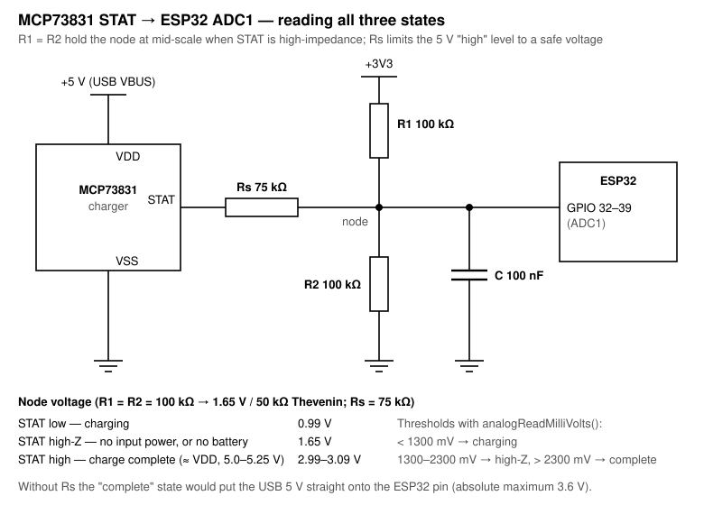

# PCBs

The custom boards of both consoles: everything needed to have them made, and to change them.

| Path | Contents |
|---|---|
| `easyeda/ProPrj_LittleGameConsole_2026-09-30.epro2` | LittleGameConsole: the editable EasyEDA Pro project - schematic and layout |
| `easyeda/ProPrj_TintinRocketShooter_2026-09-30.epro2` | TintinRocketShooter: the same |
| `gerber/Gerber_LittleGameConsolePCB_2026-09-30.zip` | LittleGameConsole: fabrication files, zipped as a fab expects them |
| `gerber/Gerber_PCB_TintinRocketShooter_2026-09-30.zip` | TintinRocketShooter: the same |
| `schematic_LittleGameConsole.pdf` | LittleGameConsole: the schematic as a document, readable without EasyEDA (6 sheets) |
| `schematic_TintinRocketShooter.pdf` | TintinRocketShooter: the same (7 sheets) |
| `BOM_LittleGameConsole.csv` | LittleGameConsole: bill of materials of the board, exported from EasyEDA, with LCSC part numbers |
| `BOM_TintinRocketShooter.csv` | TintinRocketShooter: the same |

The EasyEDA projects and the Gerber archives carry their export date in the file name, so a
later revision can sit beside these rather than silently replacing them.

## Ordering a board

Upload the Gerber archive of the console as it is - a standard Gerber and drill set. Nothing
in the design depends on a particular fab.

If you revise a layout, tag this repository when you order from it. A year later, "which
files made the board in my hand" then has an answer the tree alone cannot give.

## What is on the boards

From the schematics, the parts worth naming:

| Function | LittleGameConsole | TintinRocketShooter |
|---|---|---|
| Controller | ESP32-PICO-MINI-02U | ESP32-PICO-V3-02 |
| USB to serial, for flashing and the Serial Monitor | CP2102N | CP2102N |
| ESD protection of the USB lines | USBLC6-2SC6 | USBLC6-2SC6 |
| Li-ion charger | MCP73831 | MCP73831 |
| 3.3 V regulator | LD39200PU33R, 2 A LDO, fixed 3.3 V (schematic and BOM: LD39200PUR, see item 14) | NCP167BMX330TBG, LDO |
| Battery fuel gauge | MAX17048 | MAX17048 |
| I2S class-D amplifier | MAX98357A | MAX98357A |

The display, the joystick and the buttons connect to the board; the GPIO of every signal is
in the wiring table of the top-level README, which mirrors each console's `PinMap.h`. The
same section names the three pins that need care in a new layout: GPIO 12 (flash voltage),
GPIO 2 (boot mode) and the input-only GPIO 34 to 39.

The schematic is the authority for what was actually built, with one exception: the
LittleGameConsole's regulator (item 14). The BOM files list every part on the boards; the
parts that connect to them are below.

### Not on the board

| Part | LittleGameConsole | TintinRocketShooter |
|---|---|---|
| Display | ST7789, 320x240, SPI, on the 8-pin 1.0 mm connector CN600 | ST7789, 240x240, SPI, 7-pin 2.54 mm header J700 (no CS pin) |
| Battery | single-cell LiPo pack with built-in protection, on CN601 (Molex PicoBlade, 2 pins) | 18650 Li-ion cell with built-in protection, wires soldered to the board (see *Known errors*) |
| Speaker | on the 2-pin 1.0 mm connector CN602 | SMT-1028 transducer on the board (U701); an external speaker can go on the header H500 |
| On/off switch | on the board (SW600) | slide switch wired to the pads P402 (VIN), P403 (LDO enable) and P404 (GND) |
| Joystick cap | - | printed, `JoyTopCover` in [`mechanics/`](../mechanics) |

The joystick (FJ08K-S) and the buttons are on the boards and in the BOM files.

## Known errors on the TintinRocketShooter board

- **The battery connector sits too close to the display** and cannot be fitted. The
  battery's wires are soldered directly to the board instead.
- **The ESP32 reset button sits too close to the display**, which would keep it pressed. It
  is not fitted.
- **The joystick is exposed to electrostatic discharge without its cap.** Touching the bare
  joystick can discharge into the board, and the firmware then hangs. Always fit the cap
  (`JoyTopCover` in [`mechanics/`](../mechanics)). A revision should add ESD protection to
  the joystick lines, or ground the joystick's metal housing.

A revision of this board should move the battery connector and the reset button clear of
the display.

## Ideas for the next revision

None of these is a fault - both boards work as built. They are traps for whoever reworks or
re-lays-out a board, and improvements collected while writing the firmware.

### Pins

1. **GPIO 12 - flash voltage.** GPIO 12 is latched at reset and selects the flash voltage;
   high means 1.8 V, and with 3.3 V flash the board then does not boot. Today it carries SPI
   MOSI, which idles low. Keep it free of anything that can pull it high - or fix the
   voltage for good with `espefuse.py set_flash_voltage 3.3V`, after checking with
   `espefuse.py summary` whether the module has already done so (`XPD_SDIO_FORCE`). Burning
   the eFuse is irreversible and must match the module's flash.
2. **Display bus on its native pins.** The ST7789 is driven at 40 MHz because MOSI on
   GPIO 12 is not one of HSPI's native pins, which routes the whole bus through the GPIO
   matrix. Swapping MOSI and RESET (12 ↔ 13) puts every signal on its native pin and allows
   80 MHz - raising the full-frame limit from about 32 to about 65 frames per second at
   320x240. 80 MHz overclocks the panel (the ST7789 specifies 62.5 MHz), so test it on
   several units. After the swap, RESET sits on GPIO 12: a pull-up on the panel's reset
   line would then stop the board from booting, so decide this together with item 1.
3. **I2S clocks off GPIO 5 and 19.** These are the Arduino defaults for SPI `SS` and `MISO`.
   Nothing calls `SPI.begin()` today, but a library that does would take over both I2S
   clocks.
4. **GPIO 2 and the backlight** (LittleGameConsole). GPIO 2 must be low or floating at reset
   for the serial bootloader. Driving the backlight from it works because `setup()` pulls it
   low first; a backlight circuit with a pull-up would break flashing.
5. **Buttons on GPIO 34 to 39** (TintinRocketShooter). These pins have no internal pull-ups,
   so Sel (36) and the joystick button (38) depend on external resistors. Keep them
   deliberately, or move the buttons to pins with internal pull-ups.

The I2C pins 21 and 22 are the reverse of the Arduino defaults. The firmware handles this
by calling `Wire.begin(cI2C_SDA, cI2C_SCL)` before any library starts the bus; a board that
uses the default order would not depend on that.

### Charging

6. **Charge sense for the LittleGameConsole.** The TintinRocketShooter shows a "+" at the
   battery while charging, from two signals: USB present, and the charger's STAT output.
   The LittleGameConsole has neither - its GPIO 25 and 26 are buttons. A revision needs two
   free pins, the analog one on ADC1 (GPIO 32 to 39). The firmware is ready: add the pins to
   `PinMap.h` and set `BOARD_HAS_CHARGE_SENSE()` to 1 in `Board.h`. A firmware-only
   alternative was tested and dropped: the MAX17048 sees plugging in as a voltage step, but
   near full charge the step is too small to tell from the TintinRocketShooter's normal
   voltage swings. Item 12 shows where the LittleGameConsole's USB-present signal already is.
7. **Read all three states of STAT.** The MCP73831's STAT output is low while charging, high
   when charging is complete, and high-impedance with no input power or no battery. A
   digital input cannot tell high-impedance from high. Bias the sense node with two
   100 kΩ resistors to 3.3 V and ground, feed STAT through a **75 kΩ series resistor**, and
   add 100 nF to ground; one ADC reading then gives about 0.99 V (charging), 1.65 V
   (high-impedance) or 3.0 V (complete). The series resistor matters: the charger runs
   from USB, so STAT high is about 5 V, beyond the ESP32's 3.6 V maximum. Schematic:
   [`STAT_TriState.svg`](STAT_TriState.svg). The TintinRocketShooter already brings STAT to
   GPIO 25 through a 10 kΩ / 20 kΩ divider, which keeps "high" at 3.3 V.

### Larger changes

8. **ESP32-S3 with PSRAM.** Its DMA can read PSRAM, so a full-screen frame buffer in PSRAM
   could be sent to the display while the next frame is drawn; the display bus goes on
   native pins as in item 2; and it brings a faster core, a better ADC and native USB. The
   cost: FabGL does not support the S3, so the graphics move to TFT_eSPI or LovyanGFX, and
   the pin map starts over - different strapping pins (0, 3, 45, 46), native USB on GPIO
   19 and 20, octal PSRAM reserving GPIO 35 to 37, ADC1 on GPIO 1 to 10. The esp32 core
   2.0.17 supports the S3.
9. **A dedicated ADC for the joystick.** The ESP32's ADC is flat near both ends, bent above
   about 2.5 V, noisy, and not ratiometric to the potentiometers' supply; the firmware
   compensates with calibration, averaging and an expo curve. An **MCP3208** (or the
   4-channel MCP3204) on its own SPI pins, with `VREF` tied to the potentiometer supply,
   gives 12 linear, ratiometric bits in microseconds, plus spare channels for the battery
   or the STAT node. An **ADS1115** needs no new pins - it joins the I2C bus at 0x48 to
   0x4B - but converts at most about 400 times a second per axis and adds traffic to the
   bus the IMU is read on. On an ESP32-S3, measure the built-in ADC first. **Hall-effect
   joysticks** fix the other half of the problem - wear, drift and dead spots of the
   potentiometers - and work with either choice. In the firmware, JoystickUtilities reads
   each axis through a replaceable read function (`ReadFunction`), so an external ADC needs
   only its own read function, chosen by a `Board.h` setting.

### From tests and a schematic review (October 2026)

10. **Charging stops early** (TintinRocketShooter). In a test the charger reported "complete"
    at 86 to 90 %, and after replugging it stopped again within seconds. Two candidates:
    Q400 fitted the wrong way round - its body diode must point from the battery (VBAT) to
    VIN; reversed, VIN would charge the cell past the charger - or a worn cell. Check Q400
    first.
11. **CS of the display** (LittleGameConsole). R304, the 0 Ω link from GPIO 27 to the
    display's CS, is not fitted, so CS floats. It works, but a floating input can drift: fit
    R304, or pull CS to ground with about 10 kΩ.
12. **USB present from the switchover** (LittleGameConsole). The LM66200's ST output reports
    which input powers the board. It is pulled up by R401 to USB_P - 5 V - and goes nowhere.
    Pulled up to 3.3 V instead and connected to a free input, it is the USB-present signal
    of item 6. Check the polarity in the LM66200 datasheet.
13. **Supply of the USB-to-serial chip.** On both boards the CP2102N runs from the switched
    3.3 V rail, although the sheet says "bus-powered": flashing and the Serial Monitor work
    only with the console switched on, and with the console off the VBUS divider (R200,
    R201) puts about 3.4 V on a pin of the unpowered chip. Check this against the CP2102N
    datasheet, or use the bus-powered configuration.
14. **Regulator part number** (LittleGameConsole). The schematic and the BOM name
    LD39200PUR, the adjustable LD39200; with its ADJ pin tied to the output that would give
    about 0.5 V. The board carries the fixed 3.3 V version, LD39200PU33R. Name it in the
    schematic, so the BOM orders the right part.
15. **Amplifier supply.** The MAX98357A runs from the 3.3 V rail on both boards. It accepts
    2.5 to 5.5 V; fed from VIN it plays louder and keeps its current peaks off the rail of
    the ESP32 and the display.
16. **Backlight and GPIO 2** (see item 4). LittleGameConsole: check the display's backlight
    current - a GPIO is good for about 20 mA - and drive it through a small MOSFET if
    needed. TintinRocketShooter: GPIO 2 reaches the display's BLK pin through R700, but the
    firmware never drives it; leave R700 out, so a pull-up on the display cannot block
    flashing.
17. **Battery polarity.** Neither board protects against a reversed battery, and JST LiPo
    packs come with both polarities. Mark the polarity on the silkscreen, or add
    reverse-polarity protection.
18. **ESD protection for the joystick** (TintinRocketShooter, see *Known errors*). An ESD
    array close to the joystick and series resistors of about 1 kΩ in the three joystick
    lines.
19. **Speaker output** (TintinRocketShooter). There is no output filter (the
    LittleGameConsole has ferrites and 220 pF), and the on-board transducer is in parallel
    with the external-speaker header. With both fitted, the load must stay at 4 Ω or more.
20. **Missing part numbers in the BOM.** LittleGameConsole: the LEDs LED400 and LED401, the
    silicone buttons SW601 to SW603, the joystick FJ08K-S (no supplier), the
    ESP32-PICO-MINI-02U-N8R2 (no LCSC number) and the ferrites L500, L501 (GZ1608D121TF, no
    manufacturer). TintinRocketShooter: the antenna U301 (NN02-101, manufacturer "null"),
    the header J700, the silicone buttons SW700, SW701 and the joystick. Add them in the
    EasyEDA project.
21. **Library text in the BOM.** EasyEDA's part library brings `C&amp;K` for C&K, "SMT业务专用"
    ("for the SMT service") in the ferrite's name and "卧贴" ("horizontal SMD") in the
    connector part numbers. Clean them in the project, so the export is plain.
22. **Parts not to be fitted.** The 0 Ω links marked DNP (LittleGameConsole: R304, R500;
    TintinRocketShooter: R500) are counted in the BOM like any other part, and an assembly
    service may fit them. Mark them as not populated in EasyEDA, so the export leaves them
    out - or, for R304, decide item 11 first.
